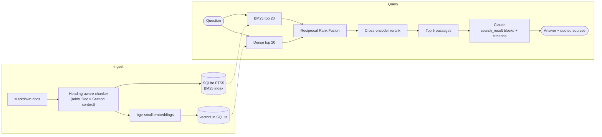

# Sourced

[](https://github.com/Bastardki11er/sourced-rag/actions/workflows/ci.yml)


Ask questions about your documentation and get answers **with citations you can check**.

Sourced is a retrieval-augmented generation (RAG) service. It indexes Markdown docs, finds
the right passages with **hybrid search** (BM25 + embeddings + a cross-encoder reranker),
and has Claude answer **only from those passages**. Every claim comes back with the exact
sentence it was based on. Retrieval quality is measured on a labelled question set, and CI
fails if it regresses.

**Stack:** Python 3.13 · FastAPI · Claude API (search-result citations) · SQLite FTS5 (BM25) · fastembed / ONNX (`bge-small-en-v1.5`, MiniLM cross-encoder) · NumPy · pytest · Ruff · Docker · GitHub Actions

## How it works



1. **Chunking follows the document's structure.** Each heading starts a chunk, and only long sections are split further, on paragraph boundaries with one paragraph of overlap. Each chunk is indexed with its heading path ("On-Call Handbook > Severity levels"), so a chunk that only says "acknowledge within 5 minutes" still matches a question about SEV1.
2. **Two retrievers, fused.** BM25 catches exact tokens like `KR-4021` or `kctl rollback`. Embeddings catch paraphrases ("file a receipt" means "submit expenses"). [Reciprocal Rank Fusion](https://plg.uwaterloo.ca/~gvcormac/cormacksigir09-rrf.pdf) merges the two rankings without trying to compare their incomparable scores.
3. **Reranking.** A cross-encoder reads the question and each candidate together and re-scores the top 20.
4. **Grounded generation.** The passages go to Claude as `search_result` content blocks with citations enabled. The API itself returns the quoted text behind each claim, so a citation can't point at text that isn't in the source. If the passages don't contain the answer, the prompt tells Claude to say so instead of guessing.

## Retrieval evaluation

48 hand-labelled questions over the bundled sample handbook ([`eval/questions.jsonl`](eval/questions.jsonl)):
23 use the handbook's own wording (*lexical*), 20 deliberately avoid it (*paraphrase*, e.g. "My robot
complains it's carrying too much" → the `KR-4021 – Payload overweight` entry), and 5 have no answer in
the handbook. Reproduce with `sourced eval eval/questions.jsonl --rerank`.

| Retriever | hit@1 | hit@3 | hit@5 | MRR | hit@3 lexical | hit@3 paraphrase |
|---|---|---|---|---|---|---|
| BM25 | 0.70 | 0.84 | 0.91 | 0.78 | 0.96 | 0.70 |
| Dense (bge-small) | 0.81 | **0.98** | **0.98** | 0.89 | 1.00 | **0.95** |
| Hybrid (RRF) | 0.84 | 0.93 | 0.93 | 0.88 | 1.00 | 0.85 |
| **Hybrid + rerank** (default) | **0.88** | 0.95 | **0.98** | **0.92** | 1.00 | 0.90 |

*hit@k: the section that holds the answer is in the top k results. MRR: mean reciprocal rank of the first correct result.*

**What the numbers say:**

- **BM25 alone collapses on paraphrases** (0.70 hit@3), which is the classic failure that motivates semantic search.
- **Plain hybrid was not a free win here.** Fusion improved the top-1 result, but BM25's noisy candidates pushed some correct paraphrase matches out of the top 3. On this small corpus with distinctive vocabulary, dense retrieval alone is already strong.
- **Adding the reranker gives the best ranking overall** (hit@1 0.88, MRR 0.92) and ties dense on hit@5, the number that decides whether the right passage reaches the LLM. So hybrid + rerank is the default for `/ask`. BM25 stays in the mix because exact identifiers matter more as a corpus grows and starts holding many near-identical passages.

Retrieval latency on an Apple M5 laptop (CPU only, 87 chunks, p50 / p95 over the 48 questions):

| BM25 | Dense | Hybrid | Hybrid + rerank |
|---|---|---|---|
| 0.1 / 0.2 ms | 2.5 / 3.3 ms | 2.4 / 3.2 ms | 113 / 128 ms |

Reranking costs ~110 ms, which is small next to LLM generation, so `/ask` reranks by default and `/search` doesn't.

CI re-runs this evaluation on every push and **fails the build if hit@5 drops below 0.95**, so a chunking or retrieval change can't silently make answers worse.

## Design decisions

| Decision | Why |
|---|---|
| Claude `search_result` blocks with citations, not "please cite your sources" in the prompt | Citations come back as structured data (`cited_text`, `source`, `title`) taken from the provided text, so they can be shown and checked in a UI |
| Server-side refusal fallback (`fallbacks: "default"`) | If a safety classifier declines a benign question, the API retries on the recommended fallback model instead of failing the request |
| SQLite for everything (FTS5 + vectors) | One file, zero infrastructure, transactional re-indexing. Brute-force cosine over a NumPy matrix takes ~2 ms here. Past a few hundred thousand chunks I'd move to an ANN index (pgvector/HNSW) |
| Local ONNX embedding and reranking models | No per-query embedding cost or third-party data sharing, deterministic for evals, and the Docker image runs offline |
| Incremental ingestion by content hash | Re-running `ingest` only re-embeds changed files. A document's chunks are swapped in one transaction |
| FTS5 queries built from quoted terms joined with `OR` | User text like `KR-4021` or `NEAR` can't be parsed as FTS5 syntax, and one rare matching term is enough to surface a chunk |
| `extractive` answerer when no API key is set | The service and its evals still run in CI and for anyone cloning the repo |

## Quickstart

```bash
python -m venv .venv && source .venv/bin/activate
pip install -e ".[dev]"

sourced ingest data/handbook            # index the sample handbook (or your own docs)
sourced search "how do I roll back?"    # retrieval only, no LLM
export ANTHROPIC_API_KEY=...            # optional: without it, answers are extractive
sourced ask "Who do I tell if my laptop is stolen?"
sourced serve                           # HTTP API on :8000, docs at /docs
```

Or with Docker (models and the sample index are baked into the image):

```bash
docker build -t sourced . && docker run -p 8000:8000 -e ANTHROPIC_API_KEY sourced
```

### API

| Method | Path | Body | Returns |
|---|---|---|---|
| `POST` | `/ask` | `{"question": "...", "top_k": 5}` | `answer` with `[n]` markers, `citations` (source, heading, quoted text), retrieved `passages`, `timings_ms` |
| `POST` | `/search` | `{"query": "...", "mode": "hybrid", "rerank": false}` | Ranked passages, with where each retriever ranked them |
| `GET` | `/health` | | Document and chunk counts, active answerer |

### Configuration

| Variable | Default |
|---|---|
| `SOURCED_CLAUDE_MODEL` | `claude-opus-5-5` |
| `SOURCED_CLAUDE_EFFORT` | `medium` |
| `SOURCED_RERANK` | `true` |
| `SOURCED_INDEX` | `.sourced/index.db` |
| `SOURCED_ANSWERER` | `claude` if `ANTHROPIC_API_KEY` is set, otherwise `extractive` |

## Tests

```bash
pytest -q        # 24 tests, ~0.2 s, no network: a hashing embedder stands in for the model
ruff check src tests
```

The tests cover heading-aware chunking (including code fences and overlap), FTS5 query sanitizing, RRF math, reranking, idempotent re-ingestion, the exact request sent to Claude (search-result blocks, citations, fallback), turning citations into numbered markers, refusal handling, API validation and error mapping, and a BM25 regression floor on the real handbook.

CI runs three jobs: lint + tests, the retrieval quality gate with real models, and a Docker smoke test that builds the image and asks it a question.

## Project layout

```
src/sourced/
├── chunking.py     heading-aware Markdown chunker
├── store.py        SQLite: documents, chunks, FTS5, embeddings
├── embeddings.py   fastembed (ONNX) embedder + deterministic test embedder
├── retrieval.py    BM25 / dense / RRF fusion / cross-encoder rerank
├── generation.py   Claude answerer with citations, extractive fallback
├── pipeline.py     ingest / search / ask
├── evaluation.py   hit@k, MRR, answer checks
├── api.py          FastAPI app
└── cli.py          sourced ingest | search | ask | eval | serve
data/handbook/      sample corpus: a fictional robotics company's engineering handbook
eval/               labelled questions
```

## Limitations and next steps

- **Answer-quality numbers need an API key.** `sourced eval --answers` checks that answers contain the expected facts, cite the right section, and decline the 5 unanswerable questions. I haven't published those numbers yet. Next would be an LLM-as-judge for faithfulness on open-ended answers.
- **The corpus is small and synthetic** (14 documents, 87 chunks), so these results show the method, not production performance. The real test is a large, messy corpus with many near-duplicate passages.
- **Streaming** (`/ask` over server-sent events) and **PDF ingestion** are not implemented yet.
- **No authentication or per-user document permissions.** A real deployment would filter retrieval by what the asker is allowed to read.

The sample handbook describes a fictional company and was written for this project.

## License

MIT
