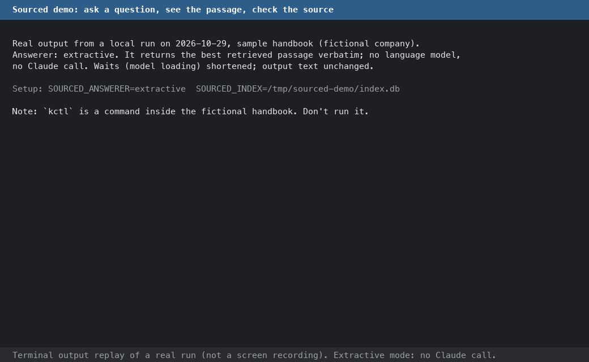

# Demo: one question, its answer, and how to check it

Three examples on the bundled sample handbook ([`data/handbook`](../data/handbook)), which describes a
**fictional** company. Commands such as `kctl` appear in its text and in answers; they are part of that
fiction. The only commands meant for your terminal are the `sourced ...` commands in
[Reproduce the extractive run](#reproduce-the-extractive-run).

1. [A Claude answer with a citation](#1-a-claude-answer-with-a-citation) (historical record)
2. [A question the handbook can't answer](#2-a-question-the-handbook-cant-answer) (historical record)
3. [The same kind of question in extractive mode](#3-the-same-kind-of-question-in-extractive-mode) (run for this page, no Claude)

## 1. A Claude answer with a citation

**Source:** a stored record of the opt-in live check
([docs/evaluation.md](evaluation.md#live-check-against-the-real-api-opt-in-paid)), recorded 2026-10-29 UTC.
Model `claude-opus-5-5`, effort `medium`, answerer `claude`, `stop_reason: end_turn`, no fallback,
1778 input / 219 output tokens, $0.0115 computed from that usage. It was **not**
re-run for this page; a new call can word the answer differently.

**Question**

~~~text
What is the command to roll back a release?
~~~

**Answer** (exactly as returned, Markdown included)

~~~text
The rollback command is `kctl rollback --to <release-id>`[1]

- **No approval needed:** Rollbacks do not need approval and should be your first move when a release causes an incident.[1]
- **Timing:** A rollback takes about 8 minutes to reach every site.[1]
- **Follow-up:** After rolling back, open a ticket so the change can be fixed before the next train.[1]
~~~

**Citation [1]**: `deployment.md`, section *Deploying to Production > Rolling back*
([data/handbook/deployment.md](../data/handbook/deployment.md#rolling-back), lines 21–29). Quoted text, as
returned by the API:

~~~text
To roll back, run:

```
kctl rollback --to <release-id>
```

Rollbacks do not need approval and should be your first move when a release causes an incident. A rollback takes about 8 minutes to reach every site. After rolling back, open a ticket so the change can be fixed before the next train.
~~~

**How to check it**

1. Open the cited section. The quote above appears there word for word (lines 23–29, the section's text
   under its heading). The handbook hasn't changed since the record was made.
2. Match each claim to the quote: the command `kctl rollback --to <release-id>`; "do not need approval";
   "about 8 minutes"; "open a ticket". All four are in it, and the answer adds nothing that isn't.
3. The citation was returned by the API as structured data, so its text comes from the passage that was
   sent. Whether the claim next to it follows from that text is what you check in step 2.

The same question was asked a second time in the same check and got the same facts and citation, formatted
differently (a code block instead of bullets).

## 2. A question the handbook can't answer

**Source:** the same check, same date, model and settings.

**Question**

~~~text
What is the company's 401(k) matching percentage?
~~~

**Answer** (exactly as returned)

~~~text
I couldn't find the 401(k) matching percentage in the handbook. The results I found cover expenses, home office stipends, API rate limits, code review, and robot error codes, but none of them mention retirement benefits. HR or the benefits team should be able to tell you.
~~~

**Citations:** none.

**How to check it**

- The handbook never mentions a 401(k), retirement or a matching percentage
  (`grep -ril -e "401(k)" -e retirement data/handbook` finds nothing).
- The five passages retrieved for this question were about Navigation errors (KR-1xxx), Automated checks, Expenses and Travel, Rate limits, Home office; the
  answer's summary of them is accurate.
- The last sentence ("HR or the benefits team ...") is general advice, not from the handbook, and carries no
  citation.
- The response's `refused` flag is `false`: that flag marks a safety refusal by the model, not "no answer".
  The decline is in the answer text.

## 3. The same kind of question in extractive mode

Run for this page on 2026-10-29 with the sample handbook, a new temporary index and the cached local models.
`SOURCED_ANSWERER=extractive`: no language model and no Claude call. The question is worded differently
from example 1 on purpose ("undo a bad release" never says "roll back").

**Retrieval** (`sourced search`, real output):

~~~text
$ sourced search "How do I undo a bad release?" --top-k 3
[1] deployment.md - Deploying to Production > Rolling back  (bm25 #3, dense #2)
    To roll back, run: ``` kctl rollback --to <release-id> ``` Rollbacks do not need approval and should be your first move when a release causes an incident. A rollback takes about 8 minutes to reach every site. After rolling back, open a ticket so the change can be fixed before the next train.
[2] incident-response.md - Incident Response > Mitigation first  (bm25 #5, dense #1)
    Restore service before you investigate. Rolling back the most recent deploy is the default first step whenever an incident starts within two hours of a release. Feature flags should be turned off before attempting a code fix.
[3] deployment.md - Deploying to Production  (bm25 #4, dense #10)
    We ship the fleet software through scheduled release trains. This page covers the schedule, the canary process, freezes, and how to roll back.
~~~

**Answer** (`sourced ask`, real output):

~~~text
$ sourced ask "How do I undo a bad release?"
To roll back, run:

```
kctl rollback --to <release-id>
```

Rollbacks do not need approval and should be your first move when a release causes an incident. A rollback takes about 8 minutes to reach every site. After rolling back, open a ticket so the change can be fixed before the next train. [1]

[1] deployment.md - Deploying to Production > Rolling back
    > To roll back, run: ``` kctl rollback --to <release-id> ``` Rollbacks do not need approval and should be your first move when a release causes an incident. A rollback takes about 8 minutes to [...]

(extractive; retrieval 106.7 ms, generation 0.0 ms)
~~~

In extractive mode the "answer" is the top-ranked passage, copied verbatim, with one citation. Nothing checks
that the passage answers the question; an unrelated question would also get a passage. The CLI shortens the
quote it prints to 200 characters (`[...]`); `/ask` returns it in full.

**Source check** (real output):

~~~text
$ sed -n '21,29p' data/handbook/deployment.md
## Rolling back

To roll back, run:

```
kctl rollback --to <release-id>
```

Rollbacks do not need approval and should be your first move when a release causes an incident. A rollback takes about 8 minutes to reach every site. After rolling back, open a ticket so the change can be fixed before the next train.
~~~

### Reproduce the extractive run

From the repository root, after the install in the [README](../README.md#try-it):

~~~bash
export SOURCED_INDEX=/tmp/sourced-demo/index.db SOURCED_ANSWERER=extractive
sourced ingest data/handbook
sourced search "How do I undo a bad release?" --top-k 3
sourced ask "How do I undo a bad release?"
sed -n '21,29p' data/handbook/deployment.md
~~~

The first run downloads the models (about 150 MB); the timings above are from cached models on a laptop.

## Terminal replay



[`demo/sourced-demo.gif`](demo/sourced-demo.gif), about 65 s. This is a **terminal output replay**, not a screen
recording: the frames are drawn from the captured output of the run in example 3, with the text unchanged.
Waits (model loading) were shortened, and each step is held long enough to read. The last frame, marked
*historical call record*, shows the text of example 1; no Claude call was made for the demo.

### Regenerating the replay

```bash
python docs/demo/render_demo.py            # or: --font /path/to/monospace.ttf
```

- **Input:** [`demo/demo-input.json`](demo/demo-input.json), the only file the script reads.
  - `extractive_run`: the commands of example 3 and their stdout, exactly as captured on 2026-10-29. To
    refresh it, rerun [the commands above](#reproduce-the-extractive-run) and paste in their output.
  - `historical_claude`: the question, answer, citation source and heading, model and settings of
    example 1, copied from the stored live-check record. The full record is not published.
- **Script:** [`demo/render_demo.py`](demo/render_demo.py). It draws each frame with Pillow and writes
  `demo/sourced-demo.gif`; it makes no network or API calls and needs no credentials. The GIF may differ
  byte for byte from the committed one (font, Pillow version), not in text.
- **Dependencies:** rendering needs only Pillow, which the runtime requirements already install (via
  fastembed), and a monospace font: Menlo on macOS or DejaVu Sans Mono on Linux are found automatically.
  Running Sourced itself (example 3) needs the normal install and the models; rendering doesn't.

## Limits

- Examples 1 and 2 come from one 12-question check on 2026-10-29, mostly one call per question. That check
  also found an unsupported phrase in another answer (p09) and quotes that are always whole chunks; see
  [docs/evaluation.md](evaluation.md#live-check-against-the-real-api-opt-in-paid). Two good examples are not
  an accuracy rate.
- The live check ran before unfinished or empty Claude replies became errors (502); both examples ended
  normally (`end_turn`), so that change doesn't affect them.
- Extractive mode has no abstention, and the bundled models target English.
